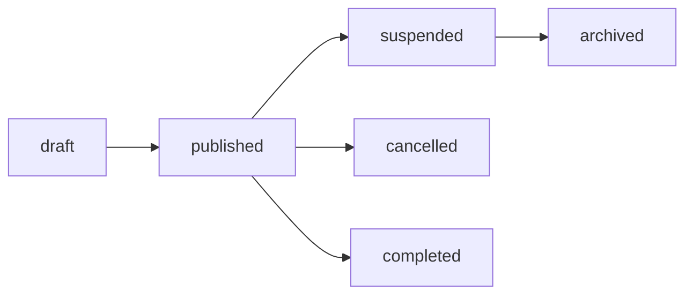
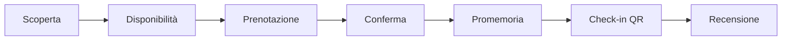

# Modello dominio

## Aggregati principali
- User: identità, ruolo e credenziali.
- OrganizerProfile: attività verificabile che pubblica eventi.
- Geography: regioni, province, comuni.
- Category: tassonomia editoriale e preferenze future.
- Event: esperienza a numero chiuso con pubblicazione diretta e post-moderazione.
- Booking: prenotazione futura con posti, QR e stati di partecipazione.
- WaitlistEntry: richiesta ordinata di posti quando l'evento è esaurito.
- Notification: comunicazione interna/email con separazione operativa/promozionale.

## Stati evento
`draft`, `published`, `sold_out`, `cancelled`, `completed`, `suspended`, `archived`.

Gli stati legacy `pending_review` e `rejected` possono esistere per compatibilita tecnica, ma non fanno piu parte del flusso operativo.

Solo `published` appare nelle API pubbliche.

## Flusso evento

## Flusso prenotazione futuro

